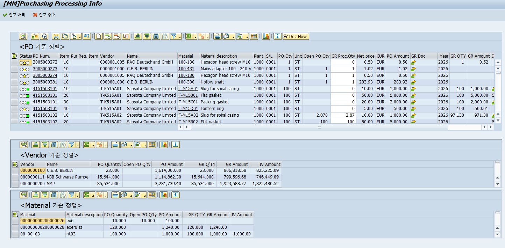
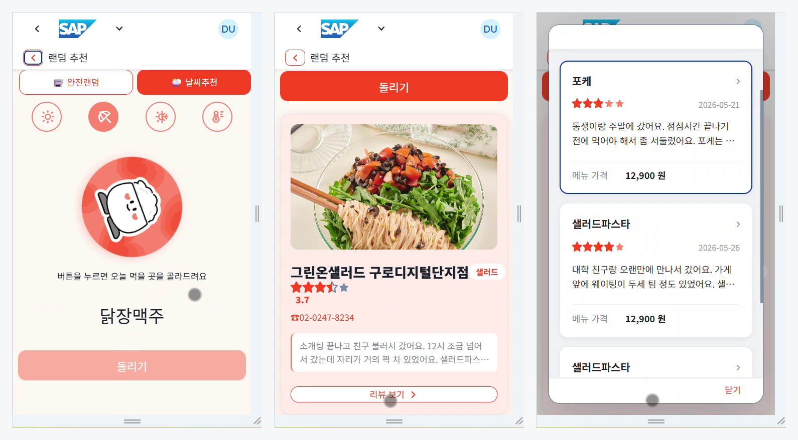

# SAP ABAP Portfolio


SAP ECC 환경에서 작성한 ABAP 코드와 SAPUI5 앱 모음입니다. 실무형 MM 프로젝트, UI5 조별 프로젝트, SAP 공식 교육과정(TAW10 · BC405 · BC414 · TAW12) 실습 코드로 구성되어 있습니다.

## 👤 About
- **이정민** — SAP ABAP Developer (신입)
- 광운대학교 경영학부 (2027.02 졸업 예정)
- SAP Certified — ABAP

## 🚀 Projects

### [📦 [MM] Purchasing Processing Info](projects/mm-purchasing-processing-info)

[](projects/mm-purchasing-processing-info)

구매오더(PO) 기반 구매 · 입고 · 송장 데이터를 한 화면에서 조회하고, BAPI로 입고 처리 / 취소까지 수행하는 MM 통합 리포트입니다.

- **Split ALV** — Container 2개 · ALV 3개 (PO 상세 + Vendor / Material 요약)
- **BAPI** — `BAPI_GOODSMVT_CREATE` (101) / `BAPI_GOODSMVT_CANCEL` + COMMIT / ROLLBACK
- **Doc Flow 팝업** — Tabstrip + 동적 Subscreen (단건 상세 / 다건 ALV 자동 전환)
- **ALV 이벤트** — Local Class로 Toolbar · User Command · Hotspot · Double Click 처리

### [🍽️ 먹고리즘 — SAPUI5 맛집 추천 앱](projects/ui5-mukgorithm)

[](projects/ui5-mukgorithm)

회사 근처 맛집 방문 기록으로 점심 메뉴를 골라주는 SAPUI5 모바일 웹앱입니다. (5인 조별 프로젝트 · **랜덤 추천 화면 · 데이터 설계 담당**)

- **랜덤 추천 화면 단독 개발** — 완전랜덤 / 날씨추천, 슬롯 연출(`setInterval` · `setTimeout`), `bindElement` 결과 카드
- **데이터 정제 · 설계** — 엑셀 620행 → 가게 80곳 × 리뷰 3건 JSON
- **계산 구조** — 평균별점 · 대표리뷰를 앱 시작 시 일괄 계산, 리뷰 저장 시 해당 가게만 재계산
- **Fragment 재사용** — 메인의 리뷰 팝업을 랜덤 화면에서 보기 전용으로 재사용

## 🛠 Tech Stack
| 영역 | 내용 |
|---|---|
| Language | ABAP (Classic / OO ABAP) |
| Environment | SAP ECC · SAP GUI (SE38 / SE51 / SE41 / SE80) |
| Module | MM (Materials Management) |
| Topics | ALV Grid · Split Container · Dialog Programming · Tabstrip · BAPI · LUW |
| Frontend | SAPUI5 (XML View · JSON / OData V2 Model · Fragment · Routing) · SAP BAS |

## 📁 Repository Structure
```
sap-abap-portfolio/
├── projects/
│   ├── mm-purchasing-processing-info/   # [MM] 구매 · 입고 · 문서흐름 리포트
│   │   ├── src/                         # Include별 ABAP 소스
│   │   ├── screens/                     # Screen Flow Logic
│   │   └── images/                      # 설계서 · 실행 화면
│   └── ui5-mukgorithm/                  # [UI5] 먹고리즘 — 맛집 랜덤 추천 앱
│       ├── webapp/                      # View · Controller · Fragment · Model
│       └── images/                      # 와이어프레임 · 구현 화면
├── mentoring/
│   └── abap-sql-quiz/                   # 멘토링용 클래식 Open SQL 문제 카드 30제
├── practice/
│   ├── taw10/                           # ABAP 기초 (Part 1·2)
│   ├── bc405/                           # Report 프로그래밍 · ALV
│   ├── bc414/                           # DB Update · LUW · Lock
│   ├── taw12/                           # 고급 ABAP · OO
│   └── ui5/                             # SAPUI5 실습 4종 (기초 · 라우팅 · 시험 · OData)
└── docs/
```

## 📌 File Naming
abapGit 규칙을 따릅니다.

| 확장자 | 오브젝트 | 트랜잭션 |
|---|---|---|
| `.prog.abap` | Report / Include | SE38 |
| `.clas.abap` | Global Class | SE24 |
| `.fugr.abap` | Function Group / Module | SE37 |
| `screen_XXXX.abap` | Screen Flow Logic | SE51 |
