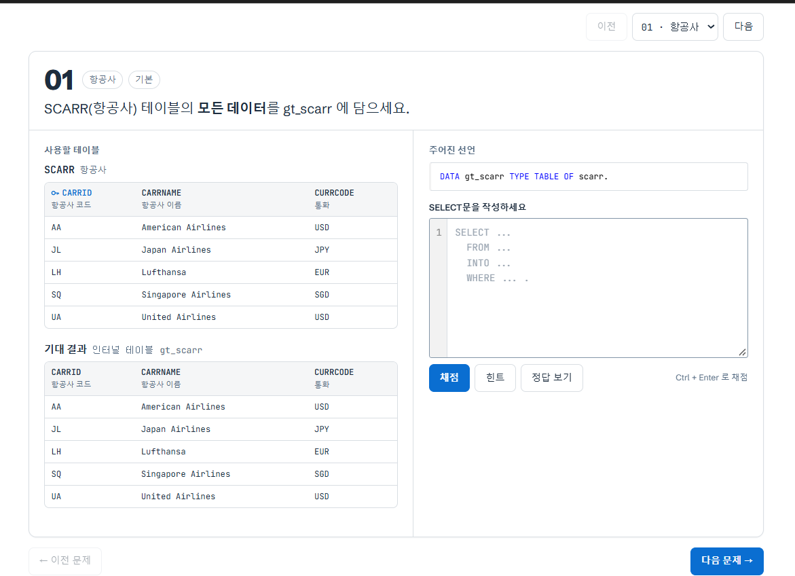

# ABAP SQL 30제

SAP CODE 아카데미 멘토링(1:2)에서 멘티 연습용으로 만든 **클래식 Open SQL 문제 카드** 웹페이지입니다.
`index.html` 하나로 동작하며, 브라우저에서 열면 바로 풀 수 있습니다.

## 구성
| 번호 | 주제 | 테이블 | 내용 |
|---|---|---|---|
| 1–15 | 항공사 | SCARR · SPFLI · SFLIGHT · SBOOK · SCUSTOMER | 1–10 기본(SELECT · WHERE · SINGLE · ORDER BY · IN · BETWEEN · LIKE), 11–15 JOIN · 집계 · GROUP BY · HAVING |
| 16–25 | 학생 | ZSTUDENT · ZSUBJECT · ZSCORE | 기본 조회 → MAX/MIN · AVG · JOIN · 학과별 평균 · LEFT OUTER JOIN |
| 26–30 | 모듈 | MARA · MAKT · EKPO (MM), BKPF (FI) | 한글 컬럼 설명으로 업무 테이블 맛보기 |

## 채점 방식
- 입력한 SELECT문을 문제 테이블에 **직접 실행**해서 기대 결과와 비교합니다. 형식이 달라도 결과가 같으면 정답입니다.
- 클래식 문법 체크: 콤마 구분 · `@` · 인라인 선언 · `SINGLE` / `INTO TABLE` 짝 · JOIN 시 `~` 필드 지정
- 결과가 다르면 원인을 짚어 줍니다: 행 수 차이, `WHERE` / `HAVING` / `GROUP BY` 누락, `ON` 조건, 필드 순서, 정렬, 대소문자
