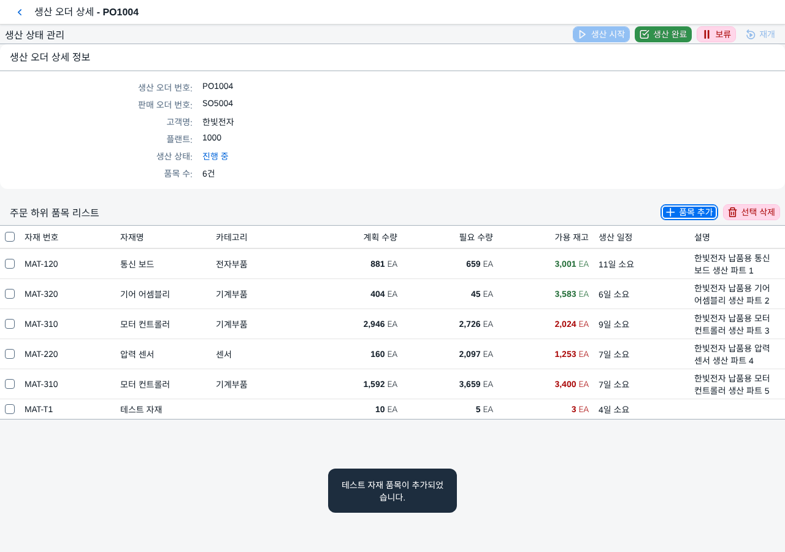

# 03. 생산 오더 관리 (UX 과정 시험)

생산 오더 목록 → 상세 → 상태 변경 · 품목 관리까지 하는 UI5 앱입니다.
시험 때 제출한 코드를 바탕으로 기능과 구조를 보완했습니다. (원본은 커밋 히스토리에 있음)

## 화면
| 화면 | 기능 |
|---|---|
| **List** | 검색 기준(오더 · 고객 · 판매오더) + 검색어 + 상태 필터, 건수 표시, 행 선택 → 상세 |
| **Detail** | `detail/{OrderID}` 라우팅, 상태 변경(시작 · 완료 · 보류 · 재개), 품목 추가 · 선택 삭제 |
| **NotFound** | 없는 오더 번호로 들어오면 `IllustratedMessage` 표시 |

## 시험 이후 보완한 점
| 원본 | 개선 |
|---|---|
| 상태 텍스트 · 색상을 View마다 긴 표현식으로 반복 | `model/formatter.js` 한 곳에서 관리 |
| 품목 추가 · 삭제 버튼만 있고 기능 없음 | 입력 팝업(Fragment) + 필수값 · 날짜 · 중복 검증, 다건 선택 삭제 + 확인 팝업 |
| 상태 변경은 시작 · 완료만 | 보류 · 재개 추가, 완료 전 확인, 완료된 오더는 품목 변경 막음 |
| 검색은 버튼 클릭 + 조건 1개 | Enter 검색, 상태 필터 AND 조건, 초기화 버튼, 목록 건수 표시 |
| 컨트롤러마다 같은 함수 · 안 쓰는 import | 공용 formatter로 정리, 불필요한 의존성 제거 |

## 핵심 코드
- **라우팅 파라미터 → 바인딩**: `attachPatternMatched` → `findIndex`로 오더 찾기 → `bindElement("/Orders/" + i)`
- **상태 변경**: `setProperty(path + "/Status", sTo)` 한 줄로 폼 · 버튼 · 목록이 같이 바뀜
- **배열 변경**: `_Items`는 새 배열로 교체해야 바인딩이 갱신됨 (`concat` / `filter`)

## 면접용 용어
- **bindElement** — View(또는 컨트롤)에 기준 경로를 정해 두고, 안쪽 필드는 상대경로로 바인딩하는 것
- **attachPatternMatched** — URL이 해당 라우트 패턴과 맞을 때마다 실행되는 이벤트 (상세 화면 진입 처리)
- **Expression Binding** — `{= ${Status} === '01' }`처럼 XML 안에서 간단한 조건식으로 값 계산
- **Formatter** — 모델 값을 화면용 값으로 바꾸는 함수 (코드 → 텍스트, 숫자 → 콤마)
