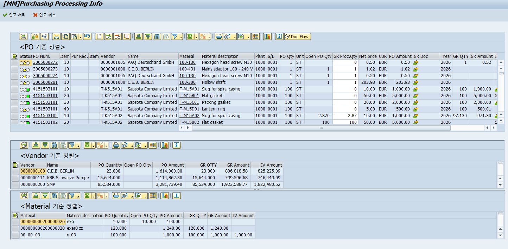
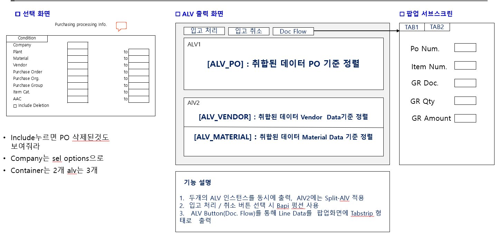

# [MM] Purchasing Processing Info

구매오더(PO) 기준으로 구매 · 입고(GR) · 송장(IR) 데이터를 한 화면에서 조회하고, 입고 처리와 취소까지 하는 ABAP 리포트입니다.

| | |
|---|---|
| 프로그램 | `YFDMM_EX2_07` |
| 기간 / 인원 | 2026.02 ~ 2026.03 / 1명 |
| 환경 | SAP ECC · SAP GUI (SE38, SE51, SE41, SE80) |
| 사용 테이블 | EKKO, EKPO, EKBE, EBAN, LFA1, MAKT |

## 주요 기능

- **조회 조건** — 회사코드(필수), 플랜트, 자재, 거래처, PO, 구매조직 · 그룹, 품목 범주, 계정 지정 범주 / 삭제된 PO 포함 체크박스
- **ALV 3개** — 위: PO 단위 상세, 아래: Splitter로 나눈 거래처 요약 · 자재 요약
- **입고 처리 / 취소** — ALV에서 입고 수량을 입력하고 버튼을 누르면 BAPI 호출
- **Doc Flow 팝업** — 선택한 라인의 GR / IR 이력을 탭으로 표시 (1건은 상세 화면, 여러 건은 ALV)
- **상태 신호등** — GR · IR 진행 상태를 빨강 / 노랑 / 초록 아이콘으로 표시
- **표준 화면 이동** — PO · 자재 · 거래처 · 구매요청 클릭 시 ME23N / MM03 / XK03 / ME53N

## 프로그램 구조

| 파일 | 역할 |
|---|---|
| [`yfdmm_ex2_07`](src/yfdmm_ex2_07.prog.abap) | 메인 — Include 선언, 이벤트 블록 |
| [`_top`](src/yfdmm_ex2_07_top.prog.abap) | 전역 데이터, ALV 출력 구조 |
| [`_sel`](src/yfdmm_ex2_07_sel.prog.abap) | 선택화면 |
| [`_cls`](src/yfdmm_ex2_07_cls.prog.abap) | ALV 이벤트 처리 로컬 클래스 (Toolbar, User Command, Hotspot, Double Click) |
| [`_o01`](src/yfdmm_ex2_07_o01.prog.abap) / [`_i01`](src/yfdmm_ex2_07_i01.prog.abap) | PBO / PAI 모듈 |
| [`_f01`](src/yfdmm_ex2_07_f01.prog.abap) | 데이터 조회 · 집계, ALV 출력, BAPI 호출 |
| [`screens/`](screens) | Screen 0100(메인), 0200(팝업), 0201 · 0202(단건), 0210 · 0211(다건 ALV) |

## 구현 포인트

**데이터 조회** — EKKO · EKPO · LFA1 · MAKT를 JOIN으로 읽고, EKBE는 `FOR ALL ENTRIES`로 따로 읽어 PO 품목별로 GR · IR 수량과 금액을 합산합니다. 입고 취소(102), 반품(122), 대변(H) 이력은 음수로 계산합니다.

**입고 처리** — `BAPI_GOODSMVT_CREATE` (GM_CODE `01`, 이동유형 `101`, MVT_IND `B`). 입고 수량이 미입고 수량을 넘지 않는지 먼저 확인하고, RETURN에 오류가 있으면 ROLLBACK, 없으면 COMMIT 후 다시 조회합니다.

**입고 취소** — `BAPI_GOODSMVT_CANCEL`. GR 문서가 여러 건인 PO는 어느 문서를 취소할지 모호해서 막고 Doc Flow에서 확인하도록 안내합니다.

**Doc Flow 팝업** — Screen 0200에 서브스크린 영역 하나를 두고, 선택한 탭과 문서 건수에 따라 0201 · 0202 · 0210 · 0211 중 하나를 넣습니다.

## 문제 해결

| 문제 | 해결 |
|---|---|
| Doc Flow 버튼 · 더블클릭 시 선택한 데이터가 팝업으로 넘어가지 않음 | `get_selected_rows`로 선택 행을 읽은 뒤 `GR_DOC`은 TAB1, `IV_DOC`은 TAB2로 연결 |
| 팝업의 X 버튼이 동작하지 않음 | PAI에 `MODULE exit_0200 AT EXIT-COMMAND` 추가 |
| 여러 건의 GR을 가진 PO의 팝업 데이터가 부족함 | ALV 데이터에는 대표 문서만 있어서, 전체 이력은 EKBE 이력 테이블에서 따로 구성 |
| Screen 0200 생성 시 `DYNPRO_SYNTAX_ERROR` | 레이아웃에 서브스크린 영역이 중복 정의돼 있어 하나만 남김 |
