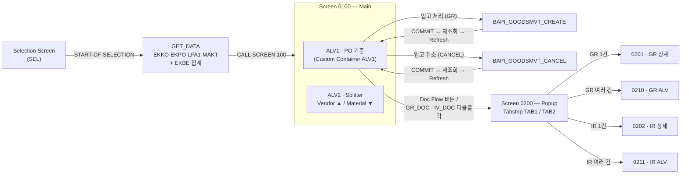
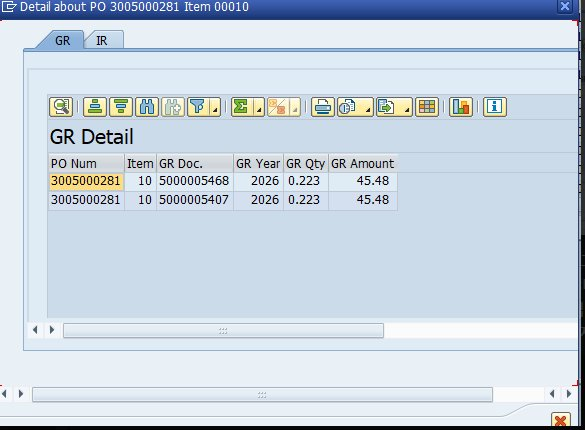

# 📦 [MM] Purchasing Processing Info

> 구매오더(PO) 기반 구매 · 입고(GR) · 송장(IR) 데이터를 한 화면에서 조회하고,<br>
> BAPI로 **입고 처리 / 취소**까지 수행하는 SAP MM 통합 리포트


---

## 📑 목차
1. [Overview](#-overview)
2. [Program Flow](#-program-flow)
3. [Program Structure](#-program-structure)
4. [Selection Screen](#-1-selection-screen)
5. [ALV1 — PO 기준 목록](#-2-alv1--po-기준-목록-go_alv_po)
6. [입고 처리 / 취소 (BAPI)](#-3-입고-처리--취소-bapi)
7. [Doc Flow 팝업](#-4-doc-flow-팝업-screen-0200)
8. [ALV2 — Vendor / Material 요약](#-5-alv2--vendor--material-요약-split-alv)
9. [Troubleshooting](#-troubleshooting)
10. [Related SAP Tables](#-related-sap-tables)

---

## 📌 Overview

| 항목 | 내용 |
|---|---|
| **Program** | `YFDMM_EX2_07` |
| **업무 영역** | SAP MM — 구매(Purchasing) / 입고관리(Goods Receipt) |
| **개발 환경** | SAP ECC · SAP GUI (SE38 / SE51 / SE41 / SE80) |
| **개발 범위** | 설계 · 선택화면 · 데이터 로직 · ALV · 이벤트 · BAPI · 팝업 **전 과정 단독 개발** |
| **핵심 기술** | Selection Screen · Split ALV · Local Event Class · BAPI · Tabstrip + Dynamic Subscreen |

**주요 기능**
- **3개 ALV 동시 출력** — PO 단위 상세(ALV1) + Vendor / Material 요약(ALV2, Splitter로 상하 분할)
- **입고 처리 / 취소** — ALV에서 입고 수량을 직접 입력하고 `BAPI_GOODSMVT_CREATE` / `BAPI_GOODSMVT_CANCEL` 호출
- **Doc Flow 팝업** — 선택한 PO 라인의 GR / IR 이력을 탭스트립 팝업으로 표시 (단건은 상세 화면, 다건은 ALV)
- **상태 신호등** — GR · IR 진행 상태를 🔴 🟡 🟢 아이콘으로 한눈에 표시
- **표준 T-Code 연결** — PO · 자재 · 거래처 · 구매요청 클릭 시 ME23N / MM03 / XK03 / ME53N 이동

---

## 🔀 Program Flow




<sub>▲ 프로그램 설계 명세서 — 선택화면 · ALV 레이아웃 · 팝업 서브스크린</sub>

---

## 🧱 Program Structure

```
mm-purchasing-processing-info/
├── src/
│   ├── yfdmm_ex2_07.prog.abap        # Main — INCLUDE 선언 · 이벤트 블록
│   ├── yfdmm_ex2_07_top.prog.abap    # 전역 데이터 · 구조 타입 · ALV 객체
│   ├── yfdmm_ex2_07_sel.prog.abap    # Selection Screen
│   ├── yfdmm_ex2_07_cls.prog.abap    # Local Class — ALV 이벤트 핸들러
│   ├── yfdmm_ex2_07_o01.prog.abap    # PBO Modules
│   ├── yfdmm_ex2_07_i01.prog.abap    # PAI Modules
│   └── yfdmm_ex2_07_f01.prog.abap    # FORM — 데이터 · ALV · BAPI 로직
├── screens/                          # Screen Flow Logic (SE51)
│   ├── screen_0100.abap              # Main (ALV1 + ALV2)
│   ├── screen_0200.abap              # Doc Flow Popup (Tabstrip)
│   ├── screen_0201.abap / 0202       # 단건 GR / IR 상세
│   └── screen_0210.abap / 0211       # 다건 GR / IR ALV
└── images/
```

| Include | 역할 | 주요 내용 |
|---|---|---|
| **Main** | 실행 흐름 | `INITIALIZATION` → `AT SELECTION-SCREEN` → `START-OF-SELECTION` → `CALL SCREEN 100` |
| **TOP** | 전역 선언 | ALV 출력 구조 3종, EKBE 이력 · 문서 집계 구조, Container · Grid 참조, `CONTROLS tc_docflow TYPE TABSTRIP` |
| **SEL** | 조회 조건 | `SELECT-OPTIONS` 9개 + 삭제 PO 포함 체크박스 |
| **CLS** | 이벤트 처리 | `toolbar` · `user_command` · `hotspot_click` · `double_click` 핸들러 |
| **O01** | PBO | PF-STATUS / TITLEBAR, ALV 생성, 탭에 따른 서브스크린 동적 결정 |
| **I01** | PAI | 종료 처리, 입고 처리 / 취소 분기, 탭 전환 |
| **F01** | 비즈니스 로직 | 데이터 조회 · 집계, Field Catalog, BAPI 호출, Doc Flow 데이터 구성 |

---

## 🔍 1. Selection Screen

| 필드 | 참조 | 필수 | 비고 |
|---|---|:---:|---|
| `S_BUKRS` | `EKKO-BUKRS` | ✅ | Company Code — `NO INTERVALS` |
| `S_WERKS` | `EKPO-WERKS` | | Plant |
| `S_MATNR` | `EKPO-MATNR` | | Material |
| `S_LIFNR` | `EKKO-LIFNR` | | Vendor |
| `S_EBELN` | `EKPO-EBELN` | | Purchase Order |
| `S_EKORG` | `EKKO-EKORG` | | Purchasing Org. |
| `S_EKGRP` | `EKKO-EKGRP` | | Purchasing Group |
| `S_PSTYP` | `EKPO-PSTYP` | | Item Category |
| `S_KNTTP` | `EKPO-KNTTP` | | Account Assignment Category |
| `P_DEL` | Checkbox | | 체크 시 삭제 표시(`LOEKZ = 'L'`)된 PO 포함 |

---

## 📊 2. ALV1 — PO 기준 목록 (`GO_ALV_PO`)

### 데이터 구성 로직

```
① EKKO ⋈ EKPO ⋈ LFA1 ⟕ MAKT         → GT_PO_RAW   (BSTYP = 'F' : PO만)
② EKBE  FOR ALL ENTRIES               → GT_PO_HIST  (VGABE 1 = GR / 2 = IR)
③ GT_PO_HIST 집계 (PO + Item 단위)    → GT_PO_DOC   (수량 · 금액 합계, 최신 문서, 건수)
④ GT_PO_RAW + GT_PO_DOC (BINARY SEARCH) → GT_ALV_PO
```

> **부호 처리** — 이동유형 `102`(입고 취소) · `122`(반품) 또는 차대지시자 `SHKZG = 'H'`인 이력은 `-1`을 곱해 합산합니다.<br>
> **최신 문서** — `BUDAT DESC, BELNR DESC`로 정렬 후 첫 번째 문서를 대표 문서로 사용합니다. 같은 날짜에 여러 건이 있는 경우까지 고려한 정렬입니다.

### 출력 필드

| 필드 | 컬럼명 | 속성 |
|---|---|---|
| `STATUS` | Status | 🔴 GR·IR 없음 / 🟡 둘 중 하나 / 🟢 GR·IR 완료 · 고정 컬럼 |
| `EBELN` · `EBELP` | PO Num. · Item | **Hotspot → ME23N** · 고정 컬럼 |
| `BANFN` · `BNFPO` | Pur Req. · Item | **더블클릭 → ME53N** · 고정 컬럼 |
| `LIFNR` · `NAME1` | Vendor · Name | **더블클릭 → XK03** · 고정 컬럼 |
| `MATNR` · `MAKTX` | Material · Description | **Hotspot → MM03** |
| `WERKS` · `LGORT` | Plant · S/L | |
| `PO_QTY` · `MEINS` | PO Qty · Unit | 수량 필드 → `MEINS` 참조 |
| `OPEN_QTY` | Open PO Qty | `PO_QTY - GR_QTY` |
| `GR_PROC_QTY` | GR Proc.Qty | ✏️ **편집 가능** — 기본값 = Open Qty |
| `NETPR` · `WAERS` · `PO_AMT` | Net price · CUR · PO Amount | 금액 필드 → `WAERS` 참조 |
| `GR_DOC` · `GR_GJAHR` · `GR_QTY` · `GR_AMT` | GR 문서 정보 | 1건이면 문서번호, 여러 건이면 `ICON_DISPLAY_MORE` · **더블클릭 → Doc Flow(TAB1)** |
| `IV_DOC` · `IV_GJAHR` · `IV_AMT` | IR 문서 정보 | 위와 동일 · **더블클릭 → Doc Flow(TAB2)** |

---

## ⚙️ 3. 입고 처리 / 취소 (BAPI)

ALV에서 행 하나를 선택하고 상단 버튼을 누르면 실행됩니다. 편집한 값을 내부 테이블에 반영하기 위해 먼저 `check_changed_data`를 호출합니다.

### 입고 처리 — `BAPI_GOODSMVT_CREATE`

**사전 검증**: 1건만 선택 · 입고 수량 > 0 · Open Qty 존재 · 입고 수량 ≤ Open Qty · Material/Plant 존재

| 구조 | 필드 | 값 |
|---|---|---|
| `GOODSMVT_HEADER` | `PSTNG_DATE` / `DOC_DATE` | `SY-DATUM` |
| | `REF_DOC_NO` | PO 번호 |
| `GOODSMVT_CODE` | `GM_CODE` | `'01'` (GR for PO) |
| `GOODSMVT_ITEM` | `MOVE_TYPE` | `'101'` |
| | `MVT_IND` | `'B'` (Goods movement for PO) |
| | `PO_NUMBER` / `PO_ITEM` | 선택 행의 PO · Item |
| | `MATERIAL` / `PLANT` / `STGE_LOC` | 선택 행 값 |
| | `ENTRY_QNT` / `ENTRY_UOM` | `GR_PROC_QTY` / `MEINS` |

### 입고 취소 — `BAPI_GOODSMVT_CANCEL`

| 파라미터 | 값 |
|---|---|
| `MATERIALDOCUMENT` / `MATDOCUMENTYEAR` | 선택 행의 최신 GR 문서 |
| `GOODSMVT_PSTNG_DATE` | `SY-DATUM` |

> GR 문서가 여러 건인 PO는 어느 문서를 취소할지 모호하므로 차단하고, Doc Flow에서 확인하도록 안내합니다.

### 공통 처리

```
RETURN에 A / E / X 메시지 존재 → BAPI_TRANSACTION_ROLLBACK + 에러 메시지
그 외                         → BAPI_TRANSACTION_COMMIT (WAIT = 'X')
                                → GET_DATA 재조회 → 3개 ALV Refresh → 자재문서 번호 메시지
```

---

## 🪟 4. Doc Flow 팝업 (Screen 0200)

| 진입 방법 | 열리는 탭 |
|---|---|
| ALV 툴바의 **Doc Flow** 버튼 (1건 선택) | 마지막으로 연 탭 |
| `GR_DOC` 셀 더블클릭 | TAB1 (GR) |
| `IV_DOC` 셀 더블클릭 | TAB2 (IR) |

| 탭 | 해당 문서 1건 | 해당 문서 여러 건 |
|---|---|---|
| **TAB1 — GR** | Screen `0201` 세로형 상세 | Screen `0210` GR ALV |
| **TAB2 — IR** | Screen `0202` 세로형 상세 | Screen `0211` IR ALV |

`SET_SUBSCREEN`(PBO)에서 `GV_PRESSED_TAB`과 건수 모드(`S` / `M`)를 보고 `GV_SUBSCREEN`을 결정한 뒤, Flow Logic에서 `CALL SUBSCREEN sub_doc INCLUDING sy-repid gv_subscreen`으로 하나의 서브스크린 영역에 동적으로 끼워 넣습니다.


<sub>▲ GR 다건 팝업 — PO 3005000281 / Item 10의 GR 이력 2건</sub>

---

## 📊 5. ALV2 — Vendor / Material 요약 (Split ALV)

`CL_GUI_SPLITTER_CONTAINER`(2행 × 1열)로 하나의 Custom Container를 상하로 나눠 두 개의 ALV를 배치했습니다. **Container 2개 · ALV 3개** 구성입니다.

| ALV | 집계 기준 | 출력 필드 |
|---|---|---|
| **Vendor** (상단) | `LIFNR` | Vendor · Name · PO Qty · Open Qty · PO Amount · GR Qty · GR Amount · IV Amount |
| **Material** (하단) | `MATNR` | Material · Description · 위와 동일한 수량 · 금액 필드 |

ALV1 데이터를 `COLLECT`로 키(Vendor / Material) 단위 합산합니다. 자재 없는 PO 라인(서비스 등)은 Material 요약에서 제외됩니다.

---

## 🛠 Troubleshooting

개발 중 30개 이상의 이슈를 **원인 분석 → 격리 테스트 → 재통합 → 검증** 순서로 해결했습니다. 대표 사례입니다.

| # | 문제 | 원인 · 해결 |
|:-:|---|---|
| 1 | Doc Flow 버튼 · 더블클릭 시 선택한 데이터가 팝업으로 전달되지 않음 | 이벤트 처리와 행 읽기 로직이 분리돼 있었음 → `get_selected_rows`로 행을 읽은 뒤 `GR_DOC`은 TAB1, `IV_DOC`은 TAB2로 분기 |
| 2 | 상태 메시지가 빨간 에러처럼 표시됨 | `MESSAGE ... TYPE 'S' DISPLAY LIKE 'E'`는 타입은 S(실행 계속)이고 표시만 E 스타일 → 화면을 멈추지 않는 경고용으로 의도적으로 사용 |
| 3 | `lt_rows` 조회 후 `gt_alv_po`를 다시 읽는 구조가 비효율적으로 보임 | `lt_rows`는 선택 행 **인덱스**만, `gt_alv_po`는 실제 **데이터**를 보유 → 인덱스 → 데이터 2단계 조회가 ALV 표준 패턴 |
| 4 | 팝업에서 X 버튼을 눌러도 닫히지 않음 | PAI에 `MODULE exit_0200 AT EXIT-COMMAND` 추가 → `LEAVE TO SCREEN 0` 정상 동작 |
| 5 | 다건 GR을 가진 PO의 Doc Flow 데이터 소스가 불명확 | `gt_alv_po`는 PO당 대표 문서만 보유 → 전체 이력은 `gt_po_hist`에서 따로 구성(`BUILD_DOCFLOW_MULTI`) |
| 6 | 하나의 팝업에서 단건 · 다건 표시를 깔끔하게 나눌 화면 구조가 필요 | Screen 0200에 서브스크린 영역 `SUB_DOC` 하나만 두고 0201/0202(단건) · 0210/0211(다건)을 동적으로 교체 |
| 7 | Screen 0200 생성 시 `DYNPRO_SYNTAX_ERROR` | 레이아웃에 `SUB_DOC` 서브스크린 영역이 중복 정의돼 있었음 → 하나만 남기고 제거 |

---

## 💡 What I Learned

- **SAP 데이터 구조** — EKKO → EKPO → EKBE를 따라가며 PO · 입고 · 송장이 어떻게 연결되는지 필드가 아닌 업무 흐름으로 이해
- **사용자 중심 리포트** — 고정 컬럼, 신호등, Hotspot, 표준 T-Code 연결로 "동작하는 화면"이 아닌 "쓰기 편한 화면"을 설계
- **디버깅 프로세스** — Dynpro 오류, EXIT-COMMAND, BAPI 파라미터, ALV 이벤트 라우팅 문제를 원인 분석 → 격리 테스트 → 재통합으로 해결

---

## 📁 Related SAP Tables

| Table | 설명 | 사용 |
|---|---|---|
| `EKKO` | 구매오더 헤더 | 회사코드 · 거래처 · 통화 · 구매조직 |
| `EKPO` | 구매오더 아이템 | 자재 · 플랜트 · 수량 · 단가 · 삭제 지시자 |
| `EKBE` | 구매오더 이력 | GR(`VGABE 1`) · IR(`VGABE 2`) 문서 · 수량 · 금액 |
| `EBAN` | 구매요청 | PR 번호 참조 (`BANFN` · `BNFPO`) |
| `LFA1` | 거래처 마스터 | 거래처명 |
| `MAKT` | 자재 내역 | 자재명 (`SPRAS = SY-LANGU`) |
