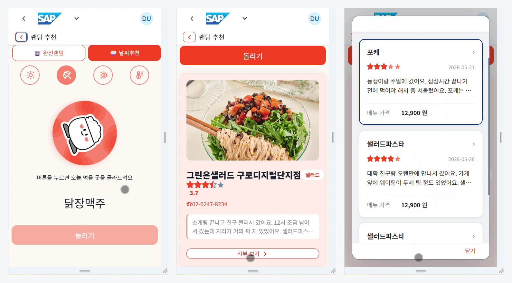
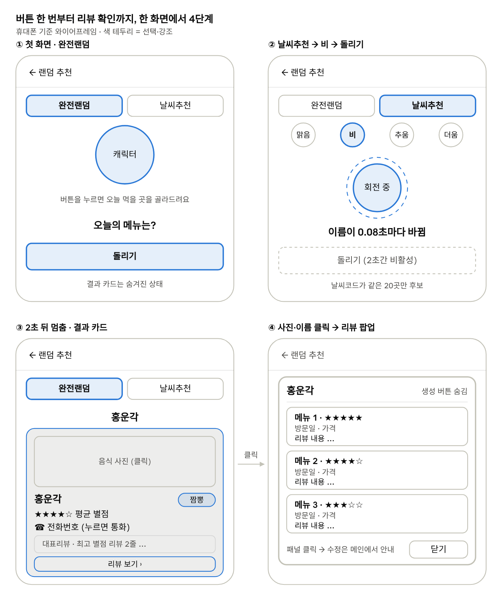
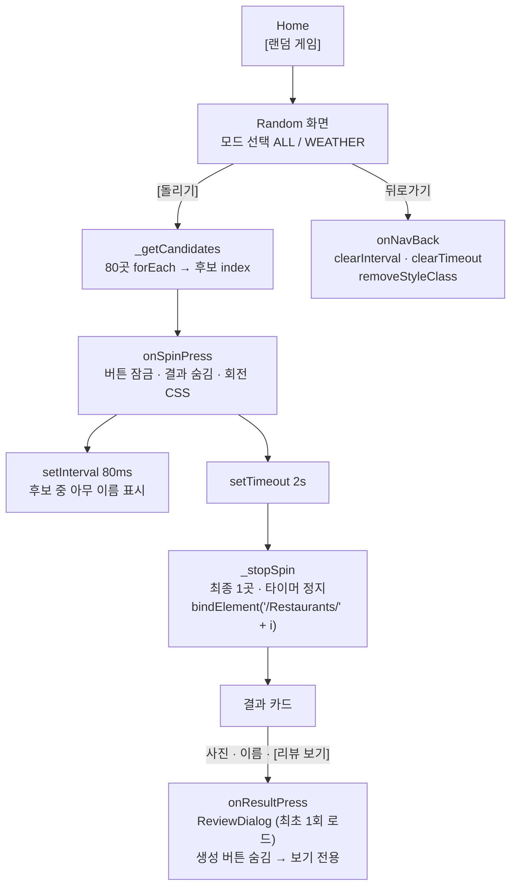

# 🍽️ 먹고리즘 — 오늘 뭐 먹지?

> 회사 근처 맛집 방문 기록으로 점심 메뉴를 골라주는 **SAPUI5 모바일 웹앱**<br>
> SAP 개발 과정 UI5 POU 조별 프로젝트 (5인) — **랜덤 추천 화면 · 데이터 설계 담당**



<sub>▲ 랜덤 추천 화면 — 날씨추천(비)으로 돌리는 중 · 결과 카드 · 리뷰 팝업(보기 전용)</sub>

---

## 📑 목차
1. [Overview](#-overview)
2. [My Role](#-my-role)
3. [App Structure](#-app-structure)
4. [랜덤 추천 화면 — 요구사항](#-랜덤-추천-화면--요구사항)
5. [랜덤 추천 화면 — 동작 흐름](#-랜덤-추천-화면--동작-흐름)
6. [데이터 설계 · 계산 구조](#-데이터-설계--계산-구조)
7. [Troubleshooting](#-troubleshooting)
8. [What I Learned](#-what-i-learned)

---

## 📌 Overview

| 항목 | 내용 |
|---|---|
| **과정** | SAP 개발 과정 UI5 POU 조별 프로젝트 · 5인 · 시연 5분 |
| **기술** | SAPUI5 1.154 · XML View · JSON Model (OData 가정) · SAP BAS |
| **주요 컨트롤** | `sap.m.List` · `SegmentedButton` · `RatingIndicator` · `Dialog` (Fragment) |
| **데이터** | 가게 80곳 × 리뷰 3건 = 240건 (카테고리 4종 × 20곳 · 날씨코드 4종 × 20곳) |

| 화면 | 내용 |
|---|---|
| **Home** | 카테고리 카드 4개(한식 · 중식 · 양식 · 기타) + 랜덤 게임 버튼 |
| **Main** | 카테고리별 식당 피드 · 별점 정렬 |
| **리뷰 팝업** | 리뷰 목록 · 생성 · 수정 (Fragment) |
| **Random** ⭐ | 완전랜덤 / 날씨추천 · 슬롯 연출 · 결과 카드 · 리뷰 팝업 재사용 |

---

## 🙋 My Role

| 담당 | 내용 | 파일 |
|---|---|---|
| **랜덤 추천 화면 단독 개발** | View · Controller · CSS를 처음부터 구현 (모드 전환 · 슬롯 연출 · 결과 카드 · 팝업 재사용) | `view/Random.view.xml`<br>`controller/Random.controller.js` |
| **데이터 정제** | 원본 엑셀 620행 → 중복 · 복사본 제거 → 실제 방문 155건 → 식당 외 기록 제외 → **80곳 × 리뷰 3건 JSON**으로 재구성, 가게 세부종류별 음식 사진 27종 매핑 | `model/restaurants.json` |
| **계산 구조 설계 · 구현** | 평균별점 · 대표리뷰 · 대표별점을 JSON에 저장하지 않고 앱 시작 시 일괄 계산, 리뷰 저장 시 해당 가게만 재계산 | `controller/App.controller.js`<br>`Main.controller.js` → `_recalcStore` |
| **공용 formatter** | `repReview` · `repRating` · `avgText` · `imageUrl` | `model/formatter.js` |
| **공통 디자인 기준** | 브랜드 색상 토큰(`--mk-primary` 등) · 폰트 정의 → 팀 공용 `style.css`의 기준 | `css/style.css` |
| **개발 명세서** | View · Controller · Fragment 이름, 컨트롤 ID, 함수명, 역할 분담을 담은 팀 스펙 작성 (v1.0 → v1.3) | — |
| **팀 코드 디버깅** | 메인 피드 별점이 0번 리뷰에 고정된 바인딩, 재계산 속성명 오타를 찾아 해결 방향 제시 | — |

> 나머지 화면은 팀원이 개발했습니다 — Home + 필터 · 정렬 / Main 피드 / 리뷰 생성 / 리뷰 수정.<br>
> 코드 주석의 `[정민]` 태그가 본인 작성 부분입니다.

---

## 🧱 App Structure

```
ui5-mukgorithm/
├── webapp/
│   ├── Component.js · manifest.json · index.html
│   ├── view/
│   │   ├── App.view.xml
│   │   ├── Home.view.xml
│   │   ├── Main.view.xml
│   │   ├── Random.view.xml              ⭐ 본인
│   │   └── fragment/
│   │       ├── ReviewDialog.fragment.xml   # 리뷰 목록 팝업 (Main · Random 공용)
│   │       └── ReviewForm.fragment.xml     # 리뷰 생성 · 수정 폼
│   ├── controller/
│   │   ├── App.controller.js            ⭐ 본인 — 평균 · 대표리뷰 일괄 계산
│   │   ├── Home.controller.js
│   │   ├── Main.controller.js           (⭐ _recalcStore)
│   │   └── Random.controller.js         ⭐ 본인
│   ├── model/
│   │   ├── formatter.js                 ⭐ 대부분 본인
│   │   ├── models.js
│   │   └── restaurants.json             ⭐ 본인 — 정제 데이터 80곳 × 리뷰 3건
│   ├── css/style.css                    (⭐ 색상 토큰 · 랜덤 화면 스타일)
│   ├── i18n/
│   └── img/
├── images/                              # README용 캡처
├── package.json
└── ui5.yaml
```

**Routing** (`manifest.json`)

| Route | Pattern | View |
|---|---|---|
| `RouteHome` | `:?query:` | Home |
| `RouteMain` | `main/{category}` | Main |
| `RouteRandom` | `random` | Random |

> ℹ️ 음식 사진 27장은 레포에 포함하지 않았습니다. 구현 화면에 나온 `salad.jpg` 1장만 들어 있어서, 로컬 실행 시 나머지 가게 사진은 표시되지 않습니다.

---

## 📋 랜덤 추천 화면 — 요구사항

**문제** — 매일 점심 메뉴를 고르는 데 시간이 들고, 엑셀에 쌓인 방문 기록은 다시 찾아보기 어렵다.<br>
**목표** — 버튼 한 번으로 고민을 끝내고, 왜 그곳인지(별점 · 대표리뷰)를 함께 보여준다.

| ID | 요구사항 | 구현 |
|:-:|---|---|
| R1 | 모드 선택: 완전랜덤 / 날씨추천 | `SegmentedButton` (`ALL` / `WEATHER`). 날씨추천일 때만 날씨 선택 표시, 모드 변경 시 이전 결과 초기화 |
| R2 | 날씨 4종 선택 | 둥근 아이콘 버튼 (`SUNNY` · `RAINY` · `COLD` · `HOT`). 선택한 key와 `WeatherCode`가 같은 20곳만 후보 |
| R3 | 슬롯 연출 | 0.08초마다 가게 이름 교체(`setInterval`), 2초 뒤 정지(`setTimeout`), 도는 동안 캐릭터 회전(CSS) |
| R4 | 결과 카드 | 사진 · 이름 · 종류 · 평균별점 · 전화 · 대표리뷰. `bindElement` 한 번으로 카드 전체 연결 |
| R5 | 리뷰 상세 | 결과 카드 클릭 → 리뷰 3건 팝업. Main의 Fragment를 재사용하고 랜덤에서는 보기 전용 |
| R6 | 중복 실행 방지 | 도는 동안 버튼 비활성. 화면을 나갈 때 타이머 2개와 회전 효과 정리 |

**비기능 요구사항**
- **반응형** — 휴대폰 우선 설계, 웹에서는 가운데 480px 고정
- **브랜드** — 메인 주황(`#FF4A22`) 계열 4단계 토큰 + 나눔스퀘어라운드 폰트. SAP 기본 테마는 클래스 범위 안에서만 덮어씀
- **팀 학습 범위 준수** — 이름 붙은 모델 없이 바인딩, 랜덤 화면 상태는 `byId`로 직접 제어
- **범위 제외** — 실제 날씨 API 연동, 랜덤 화면에서의 리뷰 생성 · 수정

---

## 🔀 랜덤 추천 화면 — 동작 흐름


<sub>▲ 와이어프레임 — 페이지 이동 없이 한 뷰 안에서 4개 상태를 오감 (보이기 · 숨기기 + `bindElement`만으로 전환)</sub>



| 함수 | 역할 |
|---|---|
| `_getCandidates` | 가게 80곳을 돌며 후보 index 수집 — 완전랜덤이면 전부, 날씨추천이면 `WeatherCode`가 같은 20곳 |
| `onSpinPress` | 버튼 잠금 → 이전 결과 숨김 → 회전 클래스 추가 → 슬롯 타이머 시작 |
| `_stopSpin` | 최종 1곳 확정 → 타이머 정지 → `bindElement`로 결과 카드 연결 → 버튼 복구 |
| `onResultPress` | 같은 경로로 리뷰 팝업 바인딩 후 열기. 팝업은 처음 한 번만 로드 |
| `onNavBack` | 타이머 2개 · 회전 효과 정리 후 Home으로 이동 |

---

## 🧮 데이터 설계 · 계산 구조

**저장값과 계산값을 분리**했습니다. JSON에는 가게와 리뷰 원본만 두고, 평균별점 · 대표리뷰 · 대표별점은 앱에서 계산합니다.

```
restaurants.json  ─ Restaurants[80]
  ├─ StoreCode · StoreName · Category(KOR/CHN/WST/ETC) · Tag · Phone · ImageUrl · WeatherCode
  └─ Reviews[3] ─ MenuCode · VisitDate · MenuName · Rating · Price · ReviewText

App.controller.onInit  (앱 시작 시 1회, dataLoaded 이후)
  └─ 80곳 전체 → AvgRating · RepReview · RepRating 을 모델에 setProperty

Main.controller._recalcStore  (리뷰 생성 · 수정 저장 시)
  └─ 해당 가게 1곳만 다시 계산 → 바인딩 · 정렬 자동 갱신
```

| formatter | 규칙 |
|---|---|
| `averageRating` | 리뷰 별점 평균, 소수 1자리 반올림 (정렬 · 표시 값 통일) |
| `repReview` / `repRating` | 별점 가장 높은 리뷰, 동점이면 최근 방문 — **같은 정렬 기준**을 써서 글자와 별점이 항상 같은 리뷰를 가리킴 |
| `avgText` | `4` → `"4.0"` 표시용 |
| `imageUrl` | `img/...` 상대경로 → `sap.ui.require.toUrl`로 앱 기준 전체 경로 |

→ Main의 별점 정렬과 Random의 결과 카드가 **같은 계산값**을 씁니다.

---

## 🛠 Troubleshooting

| # | 문제 | 원인 | 해결 |
|:-:|---|---|---|
| 1 | 런치패드 미리보기에서 로고 · 음식 사진이 안 뜸 | `img/...` 상대경로가 `webapp`이 아닌 `test/flp.html` 기준으로 해석됨 | `sap.ui.require.toUrl`로 앱 기준 경로 생성, 바인딩되는 사진은 `formatter.imageUrl` 경유 |
| 2 | 버튼을 주황으로 바꿔도 네모 배경 · 회색 테두리가 남음 | 테두리 · 배경을 그리는 건 바깥 칸이 아닌 안쪽 `.sapMSegBBtnInnerWrapper` (개발자도구로 확인) | `mkSeg` · `mkWeather` 클래스 범위 안에서 바깥 칸과 wrapper는 투명, 안쪽 버튼만 색칠 |
| 3 | 리뷰를 저장해도 피드의 평균별점 · 정렬이 안 바뀜 | 화면에서 계산하는 formatter(`{path:'Reviews'}`)는 배열 참조가 같으면 다시 실행되지 않음. formatter 값으로는 Sorter도 못 씀 | App.controller가 시작 시 일괄 계산, 저장 시 `_recalcStore`가 `AvgRating`을 다시 넣음 → 바인딩 · 정렬 자동 갱신 |
| 4 | 대표리뷰 위 별점이 다른 리뷰 점수로 나옴 | 별은 `{Reviews/0/Rating}`(0번 리뷰), 글자는 계산된 대표리뷰를 보고 있었음 | 같은 정렬 기준으로 `repRating`을 만들어 `RepRating`에 바인딩 |
| 5 | 돌리는 도중 뒤로 갔다 오면 캐릭터가 계속 회전 | 타이머 2개와 회전 CSS 클래스가 남아 있음 | `onNavBack`에서 `clearInterval` · `clearTimeout` · `removeStyleClass`로 정리 |
| 6 | Main의 팝업을 랜덤에서 열면 로드 에러 | 팝업 XML이 부르는 이벤트 함수와 formatter가 Random 컨트롤러에 없음 | 빈 핸들러와 formatter를 연결하고 생성 버튼을 숨겨 보기 전용으로 재사용 |

---

## 💡 What I Learned

- **화면 문제의 원인은 DOM 구조에 있다** — 실제로 그리는 요소를 개발자도구로 찾아야 CSS가 먹는다.
- **바인딩은 값의 변화를 전파할 뿐 다시 계산해주지 않는다** — 저장값과 계산값을 나눠 설계해야 한다.
- **팀 작업은 이름 규칙부터 고정한다** — ID · 함수 · 파일 이름을 명세서로 먼저 맞췄기 때문에 다른 팀원의 Fragment를 그대로 가져다 쓸 수 있었다.

---

## ▶️ Run

```bash
npm install
npm run start-noflp     # index.html로 바로 실행
```
